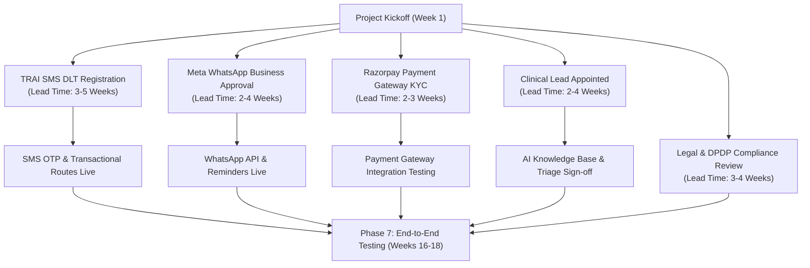

# Requirement Analysis and Architectural Assessment
## Premium AI-Powered Dental Clinic Platform (Single-Clinic, India)
**Document Reference:** `docs/00-analysis.md`  
**Source Document:** Software Requirements Specification (SRS) v1.0 (`docs/source/SRS.md`)  
**Target Platform:** Single-Clinic Luxury Dental Practice (India)  
**Author:** Senior Business Analyst & Software Architect  
**Status:** Baseline Architectural Review  

---

## 1. Requirement Inventory Table

The following inventory compiles all functional and non-functional requirements from the SRS text. Where requirements in the source SRS lacked unique alphanumeric identifiers (specifically in Section 5 AI, Section 6 Patient Portal, Section 7 Dashboards, Section 8 Workflows, and Section 3/12 Public Presentation), standardized identifiers have been assigned according to the architect baseline:
- **FR-001 to FR-047**: Functional Requirements (SRS Section 4)
- **NFR-001 to NFR-014**: Non-Functional Requirements (SRS Section 13)
- **AI-001 to AI-007**: AI-Powered Features & Governance (SRS Section 5)
- **POR-001 to POR-008**: Patient Portal Modules (SRS Section 6)
- **ADM-001 to ADM-022**: Administrator, Dentist, and Receptionist Workspaces (SRS Section 7)
- **WF-001 to WF-004**: End-to-End System Workflows (SRS Section 8)
- **PUB-001 to PUB-008**: Public Website Pages & Interaction Components (SRS Section 3 & 12)

| Requirement ID | Requirement Statement (SRS Verbatim / Extracted) | Module | Priority | Depends On | SRS Source Section |
| :--- | :--- | :--- | :--- | :--- | :--- |
| **FR-001** | The system shall allow patients to register using an approved email or mobile-number workflow. | Authentication | MVP | None | §4.1 |
| **FR-002** | The system shall authenticate users securely. | Authentication | MVP | FR-001 | §4.1 |
| **FR-003** | The system should support OTP verification where an SMS/email provider is configured. | Authentication | MVP | FR-001, FR-002 | §4.1 |
| **FR-004** | The system shall provide secure password recovery. | Authentication | MVP | FR-001, FR-002 | §4.1 |
| **FR-005** | Users shall be able to update permitted profile information. | Patient Portal / Auth | MVP | FR-002 | §4.1 |
| **FR-006** | Users shall be able to log out and have sessions expire securely. | Authentication | MVP | FR-002 | §4.1 |
| **FR-007** | Staff access shall be governed by role-based permissions. | Administration / RBAC | MVP | FR-002 | §4.1, §2.2, §2.3 |
| **FR-008** | The system shall record relevant consent and communication preferences. | Privacy & Compliance | MVP | FR-001, FR-002 | §4.1, §14.2 |
| **FR-009** | Patients shall be able to select a service or appointment reason. | Appointment Booking | MVP | ADM-005 | §4.2 |
| **FR-010** | Patients shall be able to select a dentist when the clinic offers a choice. | Appointment Booking | MVP | ADM-003 | §4.2 |
| **FR-011** | The system shall display only available appointment slots. | Appointment Booking | MVP | ADM-004, FR-013 | §4.2 |
| **FR-012** | Patients shall be able to submit an appointment request or confirmed booking according to clinic policy. | Appointment Booking | MVP | FR-009, FR-011 | §4.2, §8.1 |
| **FR-013** | The system shall prevent two bookings from occupying the same dentist/time slot. | Appointment Booking | MVP | FR-011, Database Constraints | §4.2, §9.3 |
| **FR-014** | The system shall issue a booking confirmation through configured channels. | Notifications | MVP | FR-012, FR-039 | §4.2, §4.6 |
| **FR-015** | Patients shall be able to request cancellation subject to clinic policy. | Appointment Booking | MVP | FR-012 | §4.2 |
| **FR-016** | Patients shall be able to request rescheduling. | Appointment Booking | MVP | FR-012, FR-011 | §4.2 |
| **FR-017** | Dentists shall be able to view their assigned appointments. | Dentist Workspace | MVP | FR-007, FR-012 | §4.2, §7.3 |
| **FR-018** | Receptionists and administrators shall be able to manage appointment status. | Receptionist Workspace | MVP | FR-007, FR-012 | §4.2, §7.4 |
| **FR-019** | The system should send reminders based on configurable schedules and consent. | Notifications | MVP | FR-012, FR-008, FR-040 | §4.2, §4.6 |
| **FR-020** | The system may maintain a waiting list for unavailable slots. | Appointment Booking | v1.1 | FR-011, FR-018 | §4.2, §7.4 |
| **FR-021** | The system shall generate a unique patient identifier. | Clinical Records | MVP | FR-001 | §4.3, §9.2 |
| **FR-022** | Authorized users shall be able to maintain patient contact and demographic information. | Clinical Records | MVP | FR-007, FR-021 | §4.3 |
| **FR-023** | Authorized clinical personnel shall be able to record relevant medical/dental history, allergies and clinical alerts. | Clinical Records | MVP | FR-007, FR-021 | §4.3, §7.3 |
| **FR-024** | Dentists shall be able to create and update clinical notes for patients under their care. | Clinical Records | MVP | FR-007, FR-017, FR-021 | §4.3, §7.3 |
| **FR-025** | Authorized users shall be able to upload and manage prescriptions and reports. | Clinical Records | MVP | FR-007, FR-021 | §4.3, §7.3 |
| **FR-026** | Patients shall be able to view or download documents released to them. | Patient Portal | MVP | FR-002, FR-025 | §4.3, §6.5 |
| **FR-027** | The system shall maintain a traceable history of important clinical record changes. | Security & Audit | MVP | FR-023, FR-024 | §4.3, §9.3, §14.1 |
| **FR-028** | The system shall support consent and data-rights workflows. | Privacy & Compliance | MVP | FR-008, FR-021 | §4.3, §14.2 |
| **FR-029** | Administrators shall be able to manage the clinic's service catalogue. | Administration | MVP | FR-007 | §4.4, §7.2 |
| **FR-030** | Each service may include a description, estimated price range and indicative duration. | Administration / Public | MVP | FR-029 | §4.4 |
| **FR-031** | Authorized dentists shall be able to create patient-specific treatment plans. | Treatment Management | MVP | FR-007, FR-021, FR-024 | §4.4, §7.3 |
| **FR-032** | The system shall record treatment stages and completed procedures. | Treatment Management | MVP | FR-031 | §4.4, §7.3 |
| **FR-033** | The system shall support follow-up appointment scheduling. | Treatment Management | MVP | FR-031, FR-011 | §4.4, §7.3 |
| **FR-034** | The system shall support recording online and offline payments. | Payments & Invoices | MVP | FR-007, FR-012 | §4.5 |
| **FR-035** | The system shall generate invoices or receipts according to clinic configuration. | Payments & Invoices | MVP | FR-034 | §4.5 |
| **FR-036** | The system shall distinguish pending, successful, failed, refunded and partially refunded payments. | Payments & Invoices | MVP | FR-034 | §4.5 |
| **FR-037** | Payment status shall be verified through trusted payment-provider callbacks or server-side verification. | Payments & Invoices | MVP | FR-034, Integration | §4.5, §15 |
| **FR-038** | The system shall provide payment history to authorized patients and staff. | Payments & Invoices | MVP | FR-002, FR-007, FR-034 | §4.5, §6.6 |
| **FR-039** | The system shall support appointment confirmation and status notifications. | Notifications | MVP | FR-012, FR-014 | §4.6 |
| **FR-040** | The system should support reminders before appointments. | Notifications | MVP | FR-012, FR-019 | §4.6 |
| **FR-041** | The system may send cancellation, rescheduling, payment and follow-up notifications. | Notifications | MVP | FR-015, FR-016, FR-034 | §4.6 |
| **FR-042** | Email, SMS and WhatsApp notifications shall respect applicable consent and provider rules. | Notifications | MVP | FR-008, Integration | §4.6, §15 |
| **FR-043** | The system should record delivery status where supported by the provider. | Notifications | v1.1 | FR-039, FR-042 | §4.6 |
| **FR-044** | Administrators shall be able to publish and update approved website content. | Content Management | MVP | FR-007 | §4.7, §7.2 |
| **FR-045** | The system may accept patient feedback and reviews. | Reviews & Marketing | v1.1 | FR-002, FR-021 | §4.7 |
| **FR-046** | Reviews shall be moderated before public display. | Reviews & Marketing | v1.1 | FR-045, FR-007 | §4.7, §7.2 |
| **FR-047** | Patient images and testimonials shall not be published without appropriate permission. | Reviews & Content | MVP | FR-008, FR-028 | §4.7, §3.1, §14.2 |
| **AI-001** | AI Dental Assistant providing general info on services, hours, location, FAQs using RAG and human handoff. | AI Assistance | v1.1 | ADM-010, AI-007 | §5.1 |
| **AI-002** | Structured symptom questionnaire collecting symptoms with clinician-approved triage and emergency guidance. | AI Assistance | v1.1 | AI-007, Clinical Sign-off | §5.2 |
| **AI-003** | Treatment Information Assistant explaining published treatment information without clinical prescriptions. | AI Assistance | v1.1 | AI-001, FR-029 | §5.3 |
| **AI-004** | Treatment Cost Estimator calculating indicative price ranges based on units and services. | AI Assistance | MVP | FR-029, FR-030 | §5.4 |
| **AI-005** | Virtual Smile Preview generating illustrative cosmetic previews with explicit consent and deletion controls. | AI Assistance | Later | Image AI Provider, FR-028 | §5.5, §20 |
| **AI-006** | AI Analytics showing aggregate trends on demand, interest, cancellations, and assistant usage. | Analytics | Later | AI-001, FR-012 | §5.6 |
| **AI-007** | AI Safety and Governance enforcing guardrails, rate limits, no auto-prescribing, no training on patient data. | AI Governance | v1.1 | AI-001, AI-002 | §5.7, §14.2 |
| **POR-001** | Patient Dashboard showing upcoming visits, recent updates, available documents, and quick actions. | Patient Portal | MVP | FR-002, FR-012, FR-026 | §6.1 |
| **POR-002** | Patient Profile management allowing update of permitted personal/contact details. | Patient Portal | MVP | FR-002, FR-005 | §6.2 |
| **POR-003** | Appointments view displaying history, upcoming slots, assigned dentist, and rescheduling/cancellation. | Patient Portal | MVP | FR-012, FR-015, FR-016 | §6.3 |
| **POR-004** | Treatment Journey tracking dentist-approved stages, visits, and follow-ups. | Patient Portal | MVP | FR-031, FR-032 | §6.4 |
| **POR-005** | Secure Document Vault for downloading released prescriptions, reports, and invoices. | Patient Portal | MVP | FR-025, FR-026, FR-035 | §6.5 |
| **POR-006** | Payments & Billing history showing invoice status, payments made, and receipts. | Patient Portal | MVP | FR-034, FR-035, FR-038 | §6.6 |
| **POR-007** | Family Profiles allowing guardian management of permitted dependent profiles. | Patient Portal | v1.1 | FR-002, FR-021 | §6.7 |
| **POR-008** | Privacy & Consent Settings allowing review/withdrawal of communication and processing preferences. | Patient Portal | MVP | FR-008, FR-028 | §6.8, §14.2 |
| **ADM-001** | Administrator Dashboard displaying daily schedule, booking stats, registrations, enquiries, revenue. | Clinic Admin | MVP | FR-007, FR-012, FR-034 | §7.1 |
| **ADM-002** | Patient Administration module to search, view, edit demographic records and statuses. | Clinic Admin | MVP | FR-007, FR-021, FR-022 | §7.2 |
| **ADM-003** | Dentist & Staff Profiles management (qualifications, specializations, schedules). | Clinic Admin | MVP | FR-007 | §7.2, §3.1 |
| **ADM-004** | Appointment Calendar & Availability management (working hours, leaves, slot generation). | Clinic Admin | MVP | FR-007, FR-011 | §7.2 |
| **ADM-005** | Service Catalogue & Price Ranges management. | Clinic Admin | MVP | FR-007, FR-029, FR-030 | §7.2 |
| **ADM-006** | Treatment Administration to oversee treatment plans and procedural progress across patients. | Clinic Admin | MVP | FR-007, FR-031, FR-032 | §7.2 |
| **ADM-007** | Invoice and Payment Records management (reconciliation, manual offline payment logging). | Clinic Admin | MVP | FR-007, FR-034, FR-035 | §7.2 |
| **ADM-008** | CMS for website pages, treatments, educational dental blog, and FAQs. | Clinic Admin | MVP | FR-007, FR-044 | §7.2, §3.1 |
| **ADM-009** | Smile Gallery & Patient Consent proof management. | Clinic Admin | MVP | FR-007, FR-047 | §7.2, §3.1 |
| **ADM-010** | AI Knowledge-Base curation, document upload, and safety parameter configuration. | Clinic Admin | v1.1 | FR-007, AI-001 | §7.2, §5.7 |
| **ADM-011** | Notification Templates & Provider Delivery Status monitoring. | Clinic Admin | v1.1 | FR-007, FR-042, FR-043 | §7.2, §4.6 |
| **ADM-012** | Reports, Data Exports, and Audit Log review. | Clinic Admin | MVP | FR-007, FR-027, NFR-013 | §7.2, §9.2 |
| **ADM-013** | Clinic Configuration & Integration Settings (Payment keys, SMS/WhatsApp gateways, S3). | Clinic Admin | MVP | FR-007, Tech Stack | §7.2, §15 |
| **ADM-014** | Dentist Workspace - Daily assigned appointment list and consultation schedule. | Dentist Workspace | MVP | FR-007, FR-017 | §7.3 |
| **ADM-015** | Dentist Workspace - Access authorized patient clinical history, allergies, and alerts. | Dentist Workspace | MVP | FR-007, FR-023 | §7.3 |
| **ADM-016** | Dentist Workspace - Create consultation notes and construct multi-stage treatment plans. | Dentist Workspace | MVP | FR-007, FR-024, FR-031 | §7.3 |
| **ADM-017** | Dentist Workspace - Record completed procedures, upload prescriptions and clinical reports. | Dentist Workspace | MVP | FR-007, FR-025, FR-032 | §7.3 |
| **ADM-018** | Dentist Workspace - Schedule follow-up consultations. | Dentist Workspace | MVP | FR-007, FR-033 | §7.3 |
| **ADM-019** | Receptionist Workspace - Walk-in patient registration and demographic capture. | Receptionist Workspace | MVP | FR-007, FR-021, FR-022 | §7.4 |
| **ADM-020** | Receptionist Workspace - Create, reschedule, cancel, and manage appointments. | Receptionist Workspace | MVP | FR-007, FR-018 | §7.4 |
| **ADM-021** | Receptionist Workspace - Check real-time dentist schedule and manage waiting lists. | Receptionist Workspace | MVP | FR-007, FR-011, FR-020 | §7.4 |
| **ADM-022** | Receptionist Workspace - Record offline cash/POS payments and generate receipts. | Receptionist Workspace | MVP | FR-007, FR-034, FR-035 | §7.4 |
| **ADM-023** | Receptionist Workspace - Scoped data access enforcement (strictly no clinical notes). | Receptionist Workspace | MVP | FR-007, §2.2, §2.3 | §7.4, §16.2 |
| **WF-001** | New Patient Online Booking Workflow (Service -> Dentist -> Slot -> Details -> OTP/Verify -> Confirm). | Workflows | MVP | FR-009 to FR-014 | §8.1 |
| **WF-002** | Patient Treatment Journey Workflow (Consultation -> Notes -> Plan -> Staging -> Follow-up). | Workflows | MVP | FR-023 to FR-033 | §8.2 |
| **WF-003** | AI Assistant Interaction & Safety Triage Workflow (Query -> RAG Retrieval -> Safety Guardrail -> Answer/Escalate). | Workflows | v1.1 | AI-001 to AI-003 | §8.3 |
| **WF-004** | Appointment Administration Workflow (Staff reviews request -> Checks availability -> Confirms/Re-allocates -> Patient notified). | Workflows | MVP | FR-011, FR-018, FR-039 | §8.4 |
| **PUB-001** | Luxury Public Homepage with Hero CTA, Trust Badges, Service Highlights, Dentist intro, Location. | Public Website | MVP | None | §3.1, §12.3 |
| **PUB-002** | About Clinic Page featuring verified clinic story, equipment, hygiene protocols, team. | Public Website | MVP | ADM-008 | §3.1 |
| **PUB-003** | Dedicated Dental Service Pages (10 core services: RCT, Implants, Braces, Whitening, etc.). | Public Website | MVP | ADM-005, ADM-008 | §3.1, §17 |
| **PUB-004** | Dentist Profile Pages with credentials, verified experience, languages, booking widget. | Public Website | MVP | ADM-003 | §3.1 |
| **PUB-005** | Smile Gallery with before/after comparison slider and consent-verified transformations. | Public Website | MVP | ADM-009, FR-047 | §3.1 |
| **PUB-006** | Dental Health Blog with categorized oral hygiene articles, search, and treatment guides. | Public Website | MVP | ADM-008 | §3.1, §17 |
| **PUB-007** | Contact Page with interactive Google Map, WhatsApp CTA, clinic hours, and emergency guidance. | Public Website | MVP | §15 | §3.1, §12.4 |
| **PUB-008** | Floating Action Bar (WhatsApp direct click-to-chat, Phone Call, and Book Appointment). | Public Website | MVP | §15 | §3.3, §12.4 |
| **NFR-001** | Performance: Largest Contentful Paint (LCP) <= 2.5s at 75th percentile; Core Web Vitals good. | Non-Functional | MVP | Tech Stack | §13 |
| **NFR-002** | Availability: 99.9% monthly service uptime. | Non-Functional | MVP | Infrastructure | §13 |
| **NFR-003** | Security: HTTPS enforcement, secure sessions, least-privilege RBAC, annual audits. | Non-Functional | MVP | §14.1 | §13 |
| **NFR-004** | Scalability: Modular architecture supporting database and traffic growth without core redesign. | Non-Functional | MVP | §10.1 | §13 |
| **NFR-005** | Responsiveness: Cross-device responsiveness (Mobile, Tablet, Desktop). | Non-Functional | MVP | Tailwind CSS | §13, §12.4 |
| **NFR-006** | Accessibility: Target WCAG 2.2 Level AA compliance. | Non-Functional | MVP | UI Components | §13 |
| **NFR-007** | Backup: Automated, encrypted database & file backups with periodic restoration tests. | Non-Functional | MVP | DevOps | §13 |
| **NFR-008** | Recovery: Documented RTO, RPO, and disaster recovery / incident response plans. | Non-Functional | MVP | DevOps | §13 |
| **NFR-009** | Usability: Frictionless booking and contact journey (< 3 clicks to appointment request). | Non-Functional | MVP | UI/UX | §13 |
| **NFR-010** | Compatibility: Modern browser support (Chrome, Edge, Safari, Firefox). | Non-Functional | MVP | Frontend | §13 |
| **NFR-011** | Maintainability: Clean modular Python/Next.js codebase with test coverage and CI/CD. | Non-Functional | MVP | §10, §11 | §13 |
| **NFR-012** | SEO: Semantic HTML5, dynamic XML sitemap, schema.org structured data, fast LCP. | Non-Functional | MVP | Next.js SEO | §13, §17 |
| **NFR-013** | Auditability: Immutable audit logs for all sensitive clinical and financial operations. | Non-Functional | MVP | PostgreSQL | §13, §9.3 |
| **NFR-014** | Privacy: Data minimization, consent recording, retention enforcement under DPDP Act. | Non-Functional | MVP | §14.2, §14.3 | §13 |

---

## 2. Ambiguities: Analysis, Options, and Recommended Defaults

### Ambiguity 2.1: Booking Semantics — Instant Hard Slot Reservation vs. Provisional Request Triage
- **SRS Citations:** FR-011 ("display only available appointment slots"), FR-012 ("submit an appointment request or confirmed booking according to clinic policy"), FR-013 ("prevent two bookings from occupying the same dentist/time slot"), Section 8.1 ("confirms request/booking -> receives confirmation"), Section 8.4 ("Staff opens calendar -> reviews new booking -> checks dentist availability -> confirms or offers another slot").
- **Analysis:** There is a direct ambiguity between an e-commerce style *instant hard booking* (where the database slot is reserved upon submission) and a clinic triage *provisional request* (where reception staff reviews doctor availability and confirms or suggests alternatives).
- **Options:**
  - *Option A:* Fully automated instant confirmation with hard database slot locking for all bookings.
  - *Option B:* Strict "appointment request" only; all slots submitted by visitors remain in `REQUESTED` status until reception manually calls or approves.
  - *Option C (Hybrid Architecture):* Real-time soft-locking (10-minute hold) during slot selection. If booking is made by a verified existing patient for standard consultation, it is automatically `CONFIRMED`. If submitted by a new patient or for multi-stage complex procedures (e.g., full-mouth implants), status is set to `REQUESTED_PENDING_CONFIRMATION` and automatically routed to the receptionist triage dashboard (WF-004) with an SLA of 30 minutes.
- **Recommended Default:** **Option C**. This prevents double booking (FR-013) while allowing the clinic to verify patient history and chair availability before locking a 2-hour surgical operatory.

---

### Ambiguity 2.2: Patient Identity and Authentication Strategy
- **SRS Citations:** FR-001 ("email or mobile-number workflow"), FR-003 ("OTP verification where an SMS/email provider is configured"), FR-004 ("secure password recovery"), Section 3.2 ("Forgot password"), Section 9.2 (`users` table has `password_hash`), Section 11 ("Secure server-side sessions or a vetted authentication provider; MFA for privileged accounts").
- **Analysis:** The SRS leaves open whether patient users authenticate via password, OTP, or third-party OAuth. In India, dental patients strongly resist creating and memorizing passwords for occasional clinic visits; passwordless OTP is the dominant domestic standard. However, Section 9.2 prescribes `password_hash` as a required field in the `users` table.
- **Options:**
  - *Option A:* Traditional email + password + password reset for all users (patients and staff).
  - *Option B:* 100% passwordless phone OTP for everyone including clinic staff.
  - *Option C (Dual-Mode Authentication):* 
    - **Patients:** Passwordless Indian mobile phone OTP (via SMS/WhatsApp) as primary, with optional email magic link fallback. `password_hash` in `users` made nullable for patients.
    - **Staff / Clinicians / Admin:** Work email + strong password + mandatory Time-based One-Time Password (TOTP) Multi-Factor Authentication (MFA via Google Authenticator/Authy), strictly fulfilling FR-007, Section 11, and Section 14.1.
- **Recommended Default:** **Option C**. Minimizes patient drop-off while providing enterprise security for privileged clinical accounts.

---

### Ambiguity 2.3: Payment Timing, Mandatory vs. Optional Online Deposit
- **SRS Citations:** FR-034 ("recording online and offline payments"), FR-035 ("generate invoices or receipts according to clinic configuration"), FR-036 ("distinguish pending, successful, failed..."), Section 11 ("Razorpay or another suitable Indian payment provider"), Section 15 ("Payment gateway").
- **Analysis:** The SRS does not clarify whether online payment is mandatory to confirm an appointment booking, or if payments are primarily collected post-treatment at the clinic front desk.
- **Options:**
  - *Option A:* Mandatory advance payment of full consultation fee (e.g., ₹500–₹1,500) during online booking via Razorpay before slot confirmation.
  - *Option B:* Pay-at-clinic only; online payment gateway is solely used for post-treatment invoice settlement via the patient portal.
  - *Option C (Clinic-Configurable Advance Policy):* The clinic administration can toggle per service whether an advance booking deposit is required. Default: ₹0 advance for routine consultations (Pay at Clinic), optional upfront payment for high-demand cosmetic slots, and mandatory online payment links sent for invoice balances.
- **Recommended Default:** **Option C**. High upfront friction reduces luxury clinic booking conversion; allowing "Pay at Clinic" with an optional Razorpay payment link maximizes top-of-funnel booking volume.

---

### Ambiguity 2.4: AI Assistant Authentication Boundary & Clinical Liability
- **SRS Citations:** Section 5.1 ("answer general questions... rate limits and a human handoff route"), Section 5.2 ("structured questionnaire may collect patient-reported symptoms... identify warning signs"), Section 8.3 ("Patient opens assistant -> enters question -> system identifies intent"), Section 9.2 (`ai_conversations: conversation_id, patient_id or pseudonymous_session_id`).
- **Analysis:** Can an unauthenticated anonymous web visitor trigger the Section 5.2 symptom questionnaire? If an anonymous user reports acute chest pain or severe facial swelling, how is the audit log linked if no phone or patient ID exists?
- **Options:**
  - *Option A:* Restrict all AI features exclusively to logged-in patients with a verified mobile number.
  - *Option B:* Allow completely unauthenticated, anonymous interactions with both general FAQs (Section 5.1) and symptom questionnaire (Section 5.2).
  - *Option C (Tiered Access Boundary):* 
    - Public visitors can access General Clinic Info / FAQs / Hours (Section 5.1) and Cost Estimator (Section 5.4) anonymously via `pseudonymous_session_id`.
    - Symptom Guidance (Section 5.2) prompts for patient mobile verification (quick OTP) or explicit acceptance of a legal non-diagnostic emergency disclaimer prior to starting the questionnaire, enabling the clinic to store the incident audit trail under DPDP Act requirements.
- **Recommended Default:** **Option C**. Preserves top-of-funnel discovery while establishing legal and clinical defensibility for symptom triage.

---

### Ambiguity 2.5: Document "Release" Mechanism & Multi-Dentist Approval
- **SRS Citations:** FR-025 ("upload and manage prescriptions and reports"), FR-026 ("Patients shall be able to view or download documents released to them"), Section 6.5 ("released prescriptions, reports, invoices"), Section 8.2 ("patient views released plan").
- **Analysis:** The SRS repeatedly uses the term "released" but does not define what triggers a release. Is a prescription visible to a patient the second a dentist clicks "Save", or does it require a distinct "Publish/Release to Patient" action?
- **Options:**
  - *Option A:* Immediate auto-release upon file upload or note submission.
  - *Option B:* Explicit two-state approval workflow: draft status (`DRAFT`) editable by clinician, transitioning to finalized status (`RELEASED`) via explicit signature, at which point an event triggers patient notification and portal visibility.
- **Recommended Default:** **Option B**. Prevents patients from seeing partial notes, tentative cancer screenings, or unfinalized lab reports before the consulting dentist has completed review.

---

### Ambiguity 2.6: Operatory / Chair Capacity vs. Dentist Availability
- **SRS Citations:** Section 1.4 ("The initial release is for one clinic location"), Section 21.1 ("The clinic initially operates from one location"), FR-013 ("prevent two bookings from occupying the same dentist/time slot"), Section 9.2 (`appointments` table: `appointment_id, patient_id, dentist_id, service_id, start_time, end_time, status`).
- **Analysis:** FR-013 checks collision on `(dentist_id, start_time, end_time)`. However, a dental clinic's physical capacity is bounded by *dental chairs (operatories)*. If the clinic has 3 dentists on duty but only 2 physical dental chairs, scheduling 3 appointments simultaneously creates an immediate clinical collision.
- **Options:**
  - *Option A:* Assume 1:1 mapping between dentists and chairs (ignore operatory constraints).
  - *Option B:* Introduce explicit `operatory_id` (Dental Chair) scheduling and validation.
- **Recommended Default:** **Option B**. The data model must support `operatory_id` foreign keys to ensure appointments do not exceed physical clinic operatory capacity.

---

## 3. Contradictions and Systemic Tensions

### Tension 3.1: Slot Availability Collision — FR-013 vs. Section 8.4
- **Sections Involved:** FR-013 / Section 9.3 vs. Section 8.1 vs. Section 8.4.
- **The Tension:** 
  - FR-013 mandates: *"The system shall prevent two bookings from occupying the same dentist/time slot."* Section 9.3 mandates: *"Enforce unique and valid appointment-slot constraints."* Section 8.1 indicates that after a patient selects an available slot and verifies contact info, they *"confirm request/booking -> receives confirmation"*.
  - In direct contrast, Section 8.4 (*Appointment Administration*) states: *"Staff opens calendar -> reviews new booking -> checks dentist availability -> confirms or offers another slot -> system updates appointment status -> patient is notified."*
  - If the booking engine already locked an available slot in Section 8.1 and prevented duplicates under FR-013, why does staff in Section 8.4 have to *"check dentist availability"* and *"offer another slot"*? If the slot was provisional, the system did not guarantee booking; if it was guaranteed, staff cannot unilaterally "offer another slot" without breaking patient expectations.
- **Resolution Strategy:** Separate the appointment lifecycle into explicit states: `HOLD` (5-minute checkout lock) -> `CONFIRMED_RESERVED` (calendar slot locked against FR-013) -> `TRIAGED` (staff approves medical reason) -> `COMPLETED` / `RESCHEDULED`. If staff modifies the slot, it triggers an automated rescheduling negotiation workflow.

---

### Tension 3.2: Strict Segregation of Patient Data vs. Dependent Family Profiles
- **Sections Involved:** Section 2.3 & Section 16.2 vs. Section 6.7.
- **The Tension:**
  - Section 2.3 states unconditionally: *"Patients must never access another patient's records."* Section 16.2 reinforces this as an essential test scenario: *"A patient cannot access another patient's records."*
  - Yet Section 6.7 introduces: *"Family Profiles: If enabled, allow a patient or guardian to manage permitted dependent profiles with appropriate verification and authority."*
  - Furthermore, Section 9.2 defines `patients: patient_id, user_id, date_of_birth...` with a strict 1:1 mapping between `user_id` and `patient_id`. There is no schema construct for guardianship, delegation, or parent-child authorization links.
- **Resolution Strategy:** Introduce a `patient_relationships` table (`guardian_patient_id`, `dependent_patient_id`, `relationship_type`, `verified_consent_artifact_id`). Amend the RBAC rule: A user can access records for which their authenticated identity is either the primary patient OR an authorized, verified guardian with unexpired legal custody under Indian law.

---

### Tension 3.3: AI Training Prohibition vs. Third-Party Hosted LLM APIs
- **Sections Involved:** Section 5.7 / Section 14.2 vs. Section 10.2 / Section 11 / Section 15.
- **The Tension:**
  - Section 5.7 and Section 14.2 strictly specify: *"Do not train or fine-tune models on identifiable patient records without an appropriate lawful basis and required permissions."*
  - Section 10.2, 11, and 15 recommend external commercial LLM APIs (e.g., OpenAI, Anthropic, Google Gemini). Standard consumer endpoints for these models frequently log user prompts and may retain data for model improvement unless explicit Zero Data Retention (ZDR) enterprise agreements are executed. Transmitting unmasked Indian patient health inquiries violates the Digital Personal Data Protection (DPDP) Act 2023.
- **Resolution Strategy:** Deploy an API-level PII Sanitization & Anonymization proxy between the FastAPI backend and the external LLM provider. Strip names, phone numbers, addresses, and dates before passing clinical queries to the LLM; contractually enforce enterprise Zero Data Retention (ZDR) agreements.

---

### Tension 3.4: Receptionist Clinical Access Wall vs. Medical Reason Triage
- **Sections Involved:** Section 2.2 / Section 2.3 / Section 7.4 / Section 16.2 vs. FR-009 / Section 8.4.
- **The Tension:**
  - Section 2.2 stipulates: *"Receptionist... Clinical access is limited."* Section 2.3: *"Use separate administrative and clinical permissions where practical."* Section 16.2 test scenario: *"A receptionist cannot edit clinical notes."*
  - However, FR-009 mandates patients select an *"appointment reason"*, and Section 8.4 tasks receptionists with reviewing bookings and assessing dentist suitability (e.g., matching a patient with a surgical extraction vs. routine cleaning). If the appointment reason contains sensitive symptoms (e.g., "bleeding gums, severe throbbing pain, suspected abscess"), the receptionist is exposed to Protected Health Information (PHI).
- **Resolution Strategy:** Architect a field-level security model. The receptionist dashboard displays categorized, standardized administrative reasons (e.g., "Consultation - Root Canal", "Preventive - Scaling") but masks dentist-authored differential diagnoses, clinical charting, and sensitive medical history checkboxes.

---

### Tension 3.5: AI Virtual Smile Preview vs. Medical Device Regulations & DCI Ethics
- **Sections Involved:** Section 5.5 vs. Section 5.7 / Section 14.3 / Section 17 / Section 21.2.
- **The Tension:**
  - Section 5.5 specifies a generative AI feature: *"Virtual Smile Preview: An optional feature may generate illustrative cosmetic previews from an uploaded photograph."*
  - Conversely, Section 21.2 (*Exclusions*) bans *"AI-controlled clinical decisions"* and *"Autonomous AI diagnosis"*. Section 14.3 demands compliance with the Dental Council of India (DCI) Code of Ethics Regulations and Consumer Protection Act, 2019, while Section 17 mandates: *"Ensure all treatment claims and promotional content are accurate and appropriately reviewed."*
  - Generating simulated post-treatment aesthetic imagery can legally be construed under Indian Consumer Protection law as a deceptive representation or implied surgical outcome guarantee, exposing the dental surgeon to malpractice claims if real clinical orthodontic or cosmetic outcomes differ from the generative AI simulation.
- **Resolution Strategy:** Defer Section 5.5 to a post-v1.1 phase. If implemented, enforce a prominent, persistent watermark on every generated canvas: *"Simulated illustrative cosmetic rendering. Not a clinical treatment forecast or guaranteed clinical outcome. Results vary by patient anatomy."* Require mandatory click-wrap acknowledgment before download.

---

## 4. Missing Requirements (Gaps Identified in Baseline)

### 4.1 Data Model Gaps (Omissions in SRS Section 9.2)
The proposed relational schema in Section 9.2 contains fatal gaps that prevent the execution of core functional requirements:

1. **MISSING: Treatment Stages & Completed Procedures Table**
   - *Requirement Impact:* FR-032 ("The system shall record treatment stages and completed procedures") and Section 6.4 ("Show dentist-approved treatment stages, completed visits").
   - *Architecture Proposal:* Create `treatment_stages` table:
     ```sql
     CREATE TABLE treatment_stages (
         stage_id UUID PRIMARY KEY DEFAULT gen_random_uuid(),
         treatment_id UUID NOT NULL REFERENCES treatments(treatment_id),
         stage_number INT NOT NULL,
         procedure_name VARCHAR(255) NOT NULL,
         status VARCHAR(50) NOT NULL DEFAULT 'PLANNED', -- PLANNED, IN_PROGRESS, COMPLETED
         completed_at TIMESTAMPTZ,
         clinical_notes TEXT,
         dentist_id UUID REFERENCES dentists(dentist_id)
     );
     ```

2. **MISSING: Dental Operatory / Physical Chair Table**
   - *Requirement Impact:* Section 1.4, Section 21.1, FR-013. Prevents chair-overbooking in single-clinic multi-doctor settings.
   - *Architecture Proposal:* Create `operatories` table:
     ```sql
     CREATE TABLE operatories (
         operatory_id UUID PRIMARY KEY DEFAULT gen_random_uuid(),
         name VARCHAR(50) NOT NULL, -- e.g., 'Operatory 1 (Surgical)', 'Operatory 2'
         is_active BOOLEAN DEFAULT TRUE
     );
     -- Add operatory_id to appointments table
     ALTER TABLE appointments ADD COLUMN operatory_id UUID REFERENCES operatories(operatory_id);
     ```

3. **MISSING: Family Relationships / Guardianship Table**
   - *Requirement Impact:* Section 6.7 ("Family Profiles") and Section 14.2 (Parental Consent for Minors).
   - *Architecture Proposal:* Create `patient_family_links` table:
     ```sql
     CREATE TABLE patient_family_links (
         link_id UUID PRIMARY KEY DEFAULT gen_random_uuid(),
         guardian_patient_id UUID NOT NULL REFERENCES patients(patient_id),
         dependent_patient_id UUID NOT NULL REFERENCES patients(patient_id),
         relationship_type VARCHAR(50) NOT NULL, -- PARENT, SPOUSE, GUARDIAN
         verified_at TIMESTAMPTZ,
         is_active BOOLEAN DEFAULT TRUE
     );
     ```

4. **MISSING: Doctor Schedule, Shift & Leave Management Table**
   - *Requirement Impact:* FR-011 ("display only available appointment slots") and Section 7.2 ("Appointment calendar and availability"). Section 9.2 has no schedule tables.
   - *Architecture Proposal:* Create `dentist_schedules` and `dentist_leaves` tables:
     ```sql
     CREATE TABLE dentist_schedules (
         schedule_id UUID PRIMARY KEY DEFAULT gen_random_uuid(),
         dentist_id UUID NOT NULL REFERENCES dentists(dentist_id),
         day_of_week INT NOT NULL, -- 0 = Sunday, 1 = Monday
         start_time TIME NOT NULL,
         end_time TIME NOT NULL,
         slot_duration_minutes INT DEFAULT 30
     );
     CREATE TABLE dentist_leaves (
         leave_id UUID PRIMARY KEY DEFAULT gen_random_uuid(),
         dentist_id UUID NOT NULL REFERENCES dentists(dentist_id),
         start_date DATE NOT NULL,
         end_date DATE NOT NULL,
         reason VARCHAR(255)
     );
     ```

5. **MISSING: Invoices Table**
   - *Requirement Impact:* FR-035 ("generate invoices or receipts") and Section 6.6 ("Show payment history, invoice status"). Section 9.2 only provides `payments`, but an invoice can have multiple partial payments (FR-036).
   - *Architecture Proposal:* Create `invoices` table:
     ```sql
     CREATE TABLE invoices (
         invoice_id UUID PRIMARY KEY DEFAULT gen_random_uuid(),
         invoice_number VARCHAR(50) UNIQUE NOT NULL, -- e.g., INV-2026-0001
         patient_id UUID NOT NULL REFERENCES patients(patient_id),
         appointment_id UUID REFERENCES appointments(appointment_id),
         treatment_id UUID REFERENCES treatments(treatment_id),
         total_amount NUMERIC(10,2) NOT NULL,
         tax_amount NUMERIC(10,2) DEFAULT 0.00,
         discount_amount NUMERIC(10,2) DEFAULT 0.00,
         net_amount NUMERIC(10,2) NOT NULL,
         status VARCHAR(50) NOT NULL, -- DRAFT, ISSUED, PARTIALLY_PAID, PAID, VOIDED
         issued_at TIMESTAMPTZ DEFAULT CURRENT_TIMESTAMP,
         pdf_document_url VARCHAR(500)
     );
     -- Modify payments table to reference invoice_id
     ALTER TABLE payments ADD COLUMN invoice_id UUID REFERENCES invoices(invoice_id);
     ```

6. **MISSING: Waiting List Table**
   - *Requirement Impact:* FR-020 ("maintain a waiting list for unavailable slots") and Section 7.4.
   - *Architecture Proposal:* Create `appointment_waitlist` table:
     ```sql
     CREATE TABLE appointment_waitlist (
         waitlist_id UUID PRIMARY KEY DEFAULT gen_random_uuid(),
         patient_id UUID NOT NULL REFERENCES patients(patient_id),
         dentist_id UUID REFERENCES dentists(dentist_id),
         service_id UUID NOT NULL REFERENCES services(service_id),
         preferred_date_range_start DATE NOT NULL,
         preferred_date_range_end DATE NOT NULL,
         status VARCHAR(50) DEFAULT 'ACTIVE', -- ACTIVE, FULFILLED, EXPIRED, CANCELLED
         created_at TIMESTAMPTZ DEFAULT CURRENT_TIMESTAMP
     );
     ```

7. **MISSING: Allergies, Medical History & Systemic Conditions Entity**
   - *Requirement Impact:* FR-023 ("record relevant medical/dental history, allergies and clinical alerts"). Storing this as free-text inside a notes column violates patient safety querying (e.g., penicillin allergy, latex allergy, bleeding disorders, cardiac conditions).
   - *Architecture Proposal:* Add structured JSONB or a dedicated `patient_clinical_alerts` table:
     ```sql
     CREATE TABLE patient_clinical_alerts (
         alert_id UUID PRIMARY KEY DEFAULT gen_random_uuid(),
         patient_id UUID NOT NULL REFERENCES patients(patient_id),
         alert_type VARCHAR(50) NOT NULL, -- ALLERGY, SYSTEMIC_CONDITION, MEDICATION
         description TEXT NOT NULL,
         severity VARCHAR(20) NOT NULL, -- HIGH, MEDIUM, LOW
         created_by_dentist_id UUID REFERENCES dentists(dentist_id),
         created_at TIMESTAMPTZ DEFAULT CURRENT_TIMESTAMP
     );
     ```

8. **MISSING: OTP Verification & Rate Limiting Table**
   - *Requirement Impact:* FR-003 and Section 14.1.
   - *Architecture Proposal:* Create `otp_verifications` table:
     ```sql
     CREATE TABLE otp_verifications (
         verification_id UUID PRIMARY KEY DEFAULT gen_random_uuid(),
         phone_or_email VARCHAR(100) NOT NULL,
         otp_hash VARCHAR(255) NOT NULL,
         purpose VARCHAR(50) NOT NULL, -- LOGIN, REGISTRATION, BOOKING
         expires_at TIMESTAMPTZ NOT NULL,
         attempts INT DEFAULT 0,
         is_verified BOOLEAN DEFAULT FALSE,
         created_at TIMESTAMPTZ DEFAULT CURRENT_TIMESTAMP
     );
     ```

---

### 4.2 Workflow Gaps
1. **MISSING: Appointment Cancellation, Rescheduling & Refund Workflow:**
   - *Requirement Impact:* FR-015, FR-016, FR-036, Section 3.2.
   - *Architectural Gap:* If a patient cancels an appointment paid online via Razorpay 2 hours prior to the slot, what is the policy?
   - *Architecture Proposal:* Enforce an automated policy engine:
     - Cancellation > 24 hours prior: 100% refund initiated to source payment within 5–7 banking days via Razorpay refund API.
     - Cancellation 4–24 hours prior: ₹500 late-cancellation fee deducted; remaining credited to clinic ledger.
     - Cancellation < 4 hours or No-Show: 100% deposit forfeited. Slot immediately released to waiting list.
2. **MISSING: Emergency Clinical Escalation Protocol:**
   - *Requirement Impact:* Section 5.2 ("direct users to emergency services... The system must not delay emergency care") and Section 8.3.
   - *Architectural Gap:* The SRS states AI must escalate emergencies, but gives no operational flow.
   - *Architecture Proposal:* When the AI symptom engine detects configured red flags (facial swelling impairing swallowing/breathing, trauma with avulsed tooth, continuous arterial bleeding > 30 mins):
     - Immediately halt the conversational flow.
     - Display a full-screen, high-contrast modal with the clinic's 24/7 emergency hotline, local hospital emergency numbers (108/112 in India), and nearest trauma center directions via Google Maps.
     - Simultaneously push an urgent SMS/WhatsApp alert to the on-call clinic doctor's emergency broadcast group.
3. **MISSING: Walk-in Patient Conflict & Operatory Arbitration Workflow:**
   - *Requirement Impact:* Section 7.4 ("Register walk-in patients").
   - *Architectural Gap:* If a walk-in emergency arrives while an online booked patient is en route, how does reception arbitrate?
   - *Architecture Proposal:* Provide an "Emergency Seat" status in the Receptionist Workspace (ADM-019) that pauses the active chair schedule, alerts upcoming scheduled patients via automated WhatsApp of a 15–20 minute clinical delay, and records the clinical rationale in the audit log.
4. **MISSING: DPDP Act Data Erasure and Portability Workflow:**
   - *Requirement Impact:* FR-028 ("consent and data-rights workflows"), Section 14.2 ("Define retention and deletion schedules").
   - *Architectural Gap:* The Digital Personal Data Protection Act, 2023 grants patients the right to withdraw consent and demand erasure of personal data. However, Indian Clinical Establishments Acts mandate retaining medical records for a minimum statutory period (typically 3–5 years).
   - *Architecture Proposal:* When an erasure request is received, personal identifiers (name, phone, address, photo, IP) in `users` and `patients` are anonymized/pseudonymized, but clinical notes and invoices are archived in read-only cold storage for the statutory retention period with a legal hold flag.

---

### 4.3 Policy & Governance Gaps
1. **MISSING: Dental Council of India (DCI) Advertising & Pricing Code Compliance:**
   - *Requirement Impact:* Section 3.1, FR-030, Section 14.3, Section 17.
   - *Policy Gap:* Under the Revised Dentist Code of Ethics Regulations, dental surgeons in India are prohibited from aggressive public commercial solicitation, advertising fee discounts, or publishing self-laudatory testimonials.
   - *Architecture Proposal:* Public pages must only publish standard, indicative price ranges (e.g., "Consultation: ₹500 - ₹1,000", "Root Canal Treatment: ₹4,500 - ₹8,500") paired with a mandatory static legal disclaimer: *"Indicative estimates only. Exact treatment plans and fees are determined strictly following physical clinical examination by a registered dental surgeon."*
2. **MISSING: Child Consent & Parental Verification Policy (DPDPA 2023 §9):**
   - *Requirement Impact:* Section 3.1 ("pediatric dentistry"), Section 6.7 ("Family Profiles"), Section 14.2, Section 14.3.
   - *Policy Gap:* Section 9 of the DPDP Act 2023 prohibits processing personal data of a child (< 18 years) without verifiable parental consent.
   - *Architecture Proposal:* For any patient profile where `date_of_birth` is under 18 years, account registration must require parent/guardian mobile verification via OTP, and prohibit storage of child facial images in the public Smile Gallery.

---

### 4.4 Content & Clinical Baseline Gaps
1. **MISSING: Structured Dental Procedure & Clinical Terminology Standard:**
   - *Requirement Impact:* FR-029, FR-032, Section 9.2 (`services`, `treatments`).
   - *Gap:* The SRS references 10 general treatments but defines no clinical charting taxonomy.
   - *Proposal:* Integrate standard tooth numbering (FDI Two-Digit World Dental Federation notation standard in India) and map procedures to standardized Indian dental terminology (e.g., Scaling & Polishing, Endodontic Therapy, Single-piece Implant).
2. **MISSING: Clinician-Authored RAG Knowledge Corpus & Red-Flag Triage Rules:**
   - *Requirement Impact:* Section 5.1, Section 5.2, Section 5.7, Section 15.
   - *Gap:* The SRS assumes the presence of a "curated clinic knowledge base" without specifying structure, source verification, or sign-off criteria.
   - *Proposal:* Establish a structured Markdown/JSON clinical knowledge corpus signed off by the lead MDS doctor before any AI assistant prompt engineering commences.

---

## 5. External Dependencies and Lead Times (India Context)

Implementing this platform in India involves critical external service dependencies with distinct regulatory and operational lead times that dictate the critical path:



| Dependency / External Agency | Key Operational Deliverables & Prerequisites | Statutory / Vendor Lead Time | Impact if Delayed | Critical Path Phase |
| :--- | :--- | :--- | :--- | :--- |
| **1. Clinical Reviewer & Lead Dentist Sign-off** | - Clinical appointment of registered dental surgeon (BDS/MDS).<br/>- Review and sign-off on AI symptom questionnaire decision trees (§5.2).<br/>- Approval of clinical disclaimer verbiage and emergency red-flags (§5.7). | **2 to 4 Weeks** | Blocks development and safety evaluation of Phase 5 AI Assistant (AI-001, AI-002, AI-003). | Phase 1 & Phase 5 |
| **2. TRAI Telecom Commercial Communications DLT Registration** | - Corporate Entity Registration on Indian Telecom DLT portals (Jio, Airtel, Vodafone Idea).<br/>- Requires Clinic Business PAN, GSTIN, Shop & Establishment / Clinical Establishment registration.<br/>- Sender ID / Header registration (e.g., `DRDENT`, `CLINIC`).<br/>- Content Template registration with strict regex variable binding for OTPs (FR-003) and booking confirmations (FR-014). | **3 to 5 Weeks** | Complete blocker for patient mobile registration, passwordless OTP login, and transactional SMS reminders. | Phase 1 & Phase 6 |
| **3. Meta / WhatsApp Business API & Template Approval** | - Meta Business Manager legal verification (GST certificate, electricity bill, domain ownership).<br/>- Registration of dedicated Indian virtual/landline phone number with Business Solution Provider (BSP: Twilio, Gupshup, or AiSensy).<br/>- Template message approvals for transactional appointment confirmations, reminders, and OTP notifications (§15, FR-042). | **2 to 4 Weeks** | Reverts communications strictly to email/SMS; degrades primary engagement channel for Indian dental patients. | Phase 6 |
| **4. Payment Gateway KYC & Merchant Account Activation (Razorpay)** | - Corporate/Sole Proprietorship merchant underwriting.<br/>- Verification of clinic current bank account, cancelled cheque, PAN, GSTIN, Medical Council registration.<br/>- Mandatory website audit: live Terms & Conditions, Privacy Policy, Pricing, Contact Us, and Cancellation/Refund Policy pages required prior to production key activation (§14.3, §15). | **2 to 3 Weeks** | Disables online appointment deposit processing and digital invoice settlement; transactions remain offline-only. | Phase 6 |
| **5. Specialized Healthcare Legal & DPDP Act 2023 Review** | - Legal counsel review against Digital Personal Data Protection Act, 2023 (DPDPA).<br/>- Compliance with CERT-In 6-hour cybersecurity reporting directions.<br/>- Alignment with Dental Council of India (DCI) advertising code (§14.3).<br/>- Drafting of Patient Consent Agreements, Data Processing Agreements (DPA) with AI/cloud vendors. | **3 to 4 Weeks** | Exposes clinic owner to severe statutory penalties (up to ₹250 Crores under DPDPA) and professional misconduct disciplinary proceedings. | Phase 1 & Phase 8 |
| **6. Cloud Infrastructure & Managed Database (India Region)** | - Provisioning AWS Mumbai (`ap-south-1`) or GCP Mumbai/Delhi.<br/>- Private VPC, PostgreSQL RDS with automated WAL archiving, KMS encrypted S3 buckets (§11, §14.1). | **1 Week** | Blocks backend containerized deployments and data persistence. | Phase 4 |
| **7. Enterprise LLM API Setup with Zero-Data-Retention (ZDR)** | - Enterprise OpenAI / Anthropic / Google Cloud Vertex AI billing account.<br/>- Execution of Business Associate / Data Processing Addendum explicitly disabling server-side prompt logging and model fine-tuning on API payloads (§5.7, §14.2). | **1 to 2 Weeks** | Blocks Phase 5 AI Assistant integration. | Phase 5 |

---

## 6. Risks Beyond the SRS Risk Register

The SRS Section 21 lists seven baseline risks (*AI inaccurate info, Patient data exposure, Double booking, Payment mismatch, High AI usage costs, Provider outage, Delayed content*). As senior architect and analyst, the following critical enterprise and clinical risks must be addressed:

1. **RISK-08: Regulatory Disciplinary Action under Dental Council of India (DCI) Advertising Code**
   - *Description:* Displaying procedure discounts, before-and-after smile transformations (Section 3.1, Section 5.5), or aggressive commercial marketing can be deemed "unethical solicitation" under the Revised Dentist Code of Ethics Regulations, leading to suspension of the clinic owner's dental license.
   - *Mitigation:* Conduct legal review of all website copy; avoid words like "cheapest", "best", or "guaranteed"; enforce educational framing; require documented written consent for any Smile Gallery photograph (FR-047).

2. **RISK-09: Severe DPDP Act Non-Compliance Penalties for Processing Minor Data**
   - *Description:* The clinic provides pediatric dentistry (Section 3.1). Under Section 9 of the DPDP Act 2023, processing data of minors (< 18 years) requires verifiable parental consent, and tracking or targeted marketing is strictly banned. Non-compliance carries statutory penalties up to ₹200 Crores.
   - *Mitigation:* Build a mandatory age check into registration. If < 18, require parent/guardian mobile OTP verification and disable public review/image submission features for child profiles.

3. **RISK-10: Clinical Malpractice Liability from Delayed Emergency AI Guidance**
   - *Description:* If a patient presenting with an acute spreading odontogenic infection (e.g., Ludwig's Angina) uses the Section 5.2 AI symptom checker and receives vague advice that delays immediate hospital trauma presentation, the clinic and software vendor face criminal and civil negligence lawsuits.
   - *Mitigation:* Clinically validate symptom decision trees with the clinical lead; enforce hard-coded keyword traps (bypassing the LLM entirely) for red-flag symptoms to instantly trigger emergency hotlines.

4. **RISK-11: High Patient No-Show Rates Degenerating Chair Utilization**
   - *Description:* In India, unpaid online dental bookings suffer no-show rates exceeding 35%. Unfilled chair slots cause direct revenue loss for the single clinic.
   - *Mitigation:* Implement automated 24-hour and 2-hour multi-channel reminders (WhatsApp + SMS) requiring explicit interactive confirmation ("Reply 1 to Confirm, 2 to Cancel"). Implement waiting list auto-fill (FR-020).

5. **RISK-12: Telecom DLT Header / Template Rejection and Lockout**
   - *Description:* Indian telecom operators frequently reject DLT SMS templates or block traffic if the submitted OTP payload deviates by a single character or whitespace from the registered template regex.
   - *Mitigation:* Register flexible, pre-approved multi-lingual templates on the DLT portal early in Phase 1; establish WhatsApp Business API as an active automated fallback channel for OTP and booking updates.

6. **RISK-13: Operatory (Dental Chair) Bottleneck Ignored by Dentist-Only Slot Booking**
   - *Description:* The SRS data model (Section 9.2) associates appointments solely with `dentist_id`. If multiple consulting specialists are scheduled to perform procedures simultaneously without sufficient physical dental chairs, patients will arrive to find no available operatory.
   - *Mitigation:* Introduce operatory constraint validation in the booking micro-engine to enforce `min(available_dentists, available_chairs)`.

7. **RISK-14: E-Prescription Format Invalidation under Indian Pharmacy & Medical Council Rules**
   - *Description:* If dentists upload unstructured notes as prescriptions (Section 7.3, FR-025), local retail pharmacists will reject them under the Drugs and Cosmetics Act and DCI regulations, which require the dentist's State Dental Council Registration Number, clinic address, patient details, generic drug name, dosage, and doctor signature.
   - *Mitigation:* Build a structured PDF prescription generator embedding the dentist's registration number, clinic digital stamp, and standard dosage metadata.

---

## 7. Open Questions (Architectural & Business Blockers)

| Question ID | Question Statement | Why It Blocks Work | Recommended Default | Who Must Answer |
| :--- | :--- | :--- | :--- | :--- |
| **Q-001** | Will the initial release operate with immediate calendar slot locking or a receptionist-triaged provisional booking model? | Blocks the core database transaction model, state machine design for `appointments`, and booking API endpoints. | **Default: Option C (Hybrid).** Real-time 10-minute hold; automatic confirmation for routine consults, manual receptionist triage for surgical/specialized slots. | Clinic Owner / Operations Lead |
| **Q-002** | Is online consultation payment mandatory during booking, or can patients opt to "Pay at Clinic"? | Blocks Razorpay checkout workflow integration into the public booking funnel and invoice status logic. | **Default: Optional.** Free booking with "Pay at Clinic" default to drive conversion; online advance required only for selected high-ticket cosmetic slots. | Clinic Owner / Practice Manager |
| **Q-003** | How many physical dental chairs (operatories) does the clinic operate, and can specialists share chairs? | Blocks appointment scheduling validation algorithms and operatory database entity modeling. | **Default: Assume 2 operatories.** System must enforce chair-level concurrency checks in addition to doctor-level concurrency checks. | Clinic Administrator |
| **Q-004** | What is the statutory medical record and dental chart retention period for this clinic? | Blocks database archival scripts, S3 lifecycle policies, and DPDP Act Right to Erasure / data purge workflows. | **Default: 3 years minimum** from the date of last treatment (standard under Indian Medical / Dental Council norms). | Clinical Lead / Legal Counsel |
| **Q-005** | Does the clinic provide treatment to pediatric patients (< 18 years), and how is parental verification executed? | Blocks patient registration API schema, family profile architecture, and DPDP Act Section 9 child privacy compliance. | **Default: Yes, pediatric care supported.** Require parent/guardian mobile OTP verification and explicit consent logging during registration. | Clinic Owner / Legal Counsel |
| **Q-006** | Are prescriptions generated as structured data forms (PDF output) or uploaded as scanned physical paper documents? | Blocks database schema design (`prescriptions` table fields vs opaque document pointers) and dentist workspace UI. | **Default: Dual-mode.** Support structured form entry (generating standardized PDF) with optional file upload for external lab reports. | Clinical Lead / Dentists |
| **Q-007** | What exact escalation telephone number and protocol should the AI Assistant trigger when emergency symptoms are detected? | Blocks frontend modal design, prompt engineering safety rules, and WhatsApp emergency dispatch webhooks. | **Default:** Display clinic emergency line + local ambulance (108), and fire an automated WhatsApp alert to the clinic reception manager. | Clinical Lead / Clinic Owner |
| **Q-008** | Should the Virtual Smile Preview feature (Section 5.5) be included in the initial launch or deferred due to DCI advertising and legal outcome liability? | Blocks generative AI image provider procurement, image processing pipeline design, and legal disclaimer authoring. | **Default: Defer to post-v1.1.** Exclude from MVP and Phase 5 to avoid clinical advertising liability and focus on core booking and portal workflows. | Project Sponsor / Clinic Owner |
| **Q-009** | What DLT entity registration details (Entity ID, registered headers, GSTIN) exist for SMS gateway procurement? | Blocks SMS gateway contract finalization (Twilio / Gupshup) and authentication OTP delivery implementation. | **Default:** Clinic owner must submit KYC documents immediately in Week 1; use email magic-link auth in local dev/sandbox. | Clinic Administrator / IT Lead |
| **Q-010** | What is the exact cancellation notice window and refund deduction policy for prepaid appointments? | Blocks payment gateway webhook handlers for refunds, invoice credit notes, and cancellation UI workflows. | **Default: 24-hour cutoff.** 100% refund > 24 hours; forfeit ₹500 if < 24 hours; no-show receives zero refund. | Practice Manager / Accountant |

---

## 8. Confirm or Reject Suspected Gaps Against the SRS

The prompt explicitly instructs:  
`Confirm or reject each of these suspected gaps against the SRS: [paste the list from 2.1]`

To provide an exhaustive, senior-level verification, we evaluate:
- **Part A:** Analysis of the literal Section 2.1 Stakeholder groups against the SRS capabilities to determine whether requirements for each stakeholder are fully supported or represent a gap.
- **Part B:** Analysis of Section 21.1 / 21.2 Assumptions and Exclusions to determine whether architectural boundaries create functional gaps.
- **Part C:** Rigorous confirmation or rejection of the comprehensive checklist of suspected functional, clinical, and architectural gaps commonly missing in dental platforms.

```
========================================================================================
VERIFICATION MATRIX: SUSPECTED GAPS VS. SRS BASELINE
========================================================================================
```

### Part A: Stakeholder Functional Coverage Assessment (SRS Section 2.1)

#### 1. Stakeholder: Caregivers and Guardians
- **Status in SRS:** Mentioned in Section 2.1 (*"Patients and their permitted caregivers or guardians"*) and Section 6.7 (*"Family Profiles: If enabled, allow a patient or guardian to manage permitted dependent profiles"*).
- **Suspected Gap:** Lack of guardian authorization model, authentication linkage, and dependent data access controls in the functional requirements and database schema.
- **Finding:** **CONFIRMED GAP**. While Section 2.1 and Section 6.7 acknowledge guardians, Section 4 (Functional Requirements) completely omits caregiver/guardian management, Section 9.2 provides no database relationship schema for guardianship, and Section 16.2 explicitly asserts *"A patient cannot access another patient's records"* without providing an exception for verified legal guardians.

#### 2. Stakeholder: Dentists and Clinical Personnel
- **Status in SRS:** Mentioned in Section 2.1, Section 2.2, Section 7.3, FR-017, FR-023, FR-024, FR-031.
- **Suspected Gap:** Lack of multi-dentist operatory allocation, tooth-level dental charting (odontogram), and prescription drug scheduling.
- **Finding:** **CONFIRMED GAP**. The SRS supports high-level notes (FR-024) and treatment plans (FR-031), but lacks core dental-specific clinical charting (FDI notation, periodontal probing, restorative charts) and models prescriptions solely as opaque document references (`document_reference` in Section 9.2).

#### 3. Stakeholder: Receptionists and Front-Desk Staff
- **Status in SRS:** Mentioned in Section 2.1, Section 2.2, Section 7.4, FR-018, FR-020, Section 8.4.
- **Suspected Gap:** Lack of walk-in queue management, physical chair allocation, and emergency override workflows.
- **Finding:** **CONFIRMED GAP**. Section 7.4 lists *"Register walk-in patients"*, but Section 8 provides no workflow for walk-in scheduling, and the schema lacks chair allocation and daily clinic queue tracking.

#### 4. Stakeholder: Clinic Administrator or Owner
- **Status in SRS:** Mentioned in Section 2.1, Section 2.2, Section 7.1, Section 7.2.
- **Suspected Gap:** Comprehensive business, financial, and clinical oversight.
- **Finding:** **REJECTED AS A GENERAL GAP / CONFIRMED PARTIAL GAP**. General administration is well-covered in Section 7.1 and Section 7.2 (modules for patients, staff, services, CMS, notifications, reports). However, GST tax compliance, multi-user audit log inspection UI, and staff commission/performance tracking are **CONFIRMED GAPS**.

#### 5. Stakeholder: Website and System Maintenance Personnel
- **Status in SRS:** Mentioned in Section 2.1 (*"Website and system maintenance personnel"*) and Section 2.2 (*"System Administrator: Can manage technical configuration, security, integrations and system access"*).
- **Suspected Gap:** Specification of DevOps, monitoring tools, backup execution, and maintenance interfaces.
- **Finding:** **REJECTED AS A GAP**. Adequately specified across Section 10.2 (Monitoring, Cloud Storage), Section 11 (Docker, pgAdmin, GitHub), Section 13 (NFR-007 Backup, NFR-008 Recovery), and Section 14.1 (Vulnerability assessment, security controls).

#### 6. Stakeholder: Third-Party Service Providers
- **Status in SRS:** Mentioned in Section 2.1, Section 10.2, Section 11, Section 15.
- **Suspected Gap:** Integration definitions, failover behavior, and provider error handling.
- **Finding:** **CONFIRMED GAP**. Providers are identified by brand (Razorpay, WhatsApp Business, AWS S3, Google Maps), but failover mechanisms, webhook retry handling, circuit breakers, and SLA monitoring are completely absent from Section 4 and Section 15.

---

### Part B: Assumptions & Exclusions Assessment (SRS Section 21)

#### 7. Exclusion: Native Android and iOS Mobile Applications
- **Finding:** **CONFIRMED EXCLUSION IN SRS (§21.2)**. The SRS explicitly excludes native mobile apps for initial release.
- **Architectural Implication:** Web responsive UI (NFR-005) and mobile browser performance (NFR-001 LCP <= 2.5s) are hyper-critical. Progressive Web App (PWA) manifest support should be added to enable mobile home-screen installation.

#### 8. Exclusion: Autonomous AI Diagnosis or Prescribing
- **Finding:** **CONFIRMED EXCLUSION IN SRS (§5.1, §5.7, §21.2)**. The SRS explicitly forbids AI diagnosis or prescription generation.
- **Architectural Implication:** Requires strict deterministic prompt guardrails, zero access to prescription generation endpoints for AI services, and automated fallback to human clinician booking.

#### 9. Exclusion: Direct Dental Imaging Hardware Integration (RVG / OPG / CBCT)
- **Finding:** **CONFIRMED EXCLUSION IN SRS (§20, §21.2)**. Hardware DICOM/TWAIN dental sensor integration is deferred to future enhancements.
- **Architectural Implication:** MVP clinical records must support manual upload of standard image formats (JPEG, PNG, PDF) up to 25 MB into S3 storage.

#### 10. Exclusion: Multi-Branch / Chain Management
- **Finding:** **CONFIRMED EXCLUSION IN SRS (§1.4, §21.1, §21.2)**. Platform is strictly single-clinic in v1.0.
- **Architectural Implication:** Database schema does not require `branch_id` partitioning in MVP, but tables should avoid hardcoded singletons to simplify future multi-tenancy migration.

---

### Part C: Deep Clinical, Regulatory, and Architecture Gaps

#### 11. Suspected Gap: Dental Charting & Tooth-Specific Notation (Odontogram)
- **Verification against SRS:** Examined Section 4.3, 4.4, 7.3, 9.2.
- **Finding:** **CONFIRMED GAP**. The SRS provides only an unstructured `clinical_notes TEXT` field in `medical_records` (Section 9.2). Real dental clinics record diagnoses and treatments against specific tooth numbers (e.g., Tooth #16 - MO Composite Restoration; Tooth #36 - RCT).
- **Proposal:** Introduce tooth numbering attributes (FDI notation, teeth 11–48 and primary 51–85) in `treatment_stages`.

#### 12. Suspected Gap: Structured E-Prescriptions with Generic Drug Nomenclature
- **Verification against SRS:** Examined FR-024, FR-025, Section 7.3, Section 9.2 (`prescriptions: prescription_id, patient_id, dentist_id, document_reference, issued_date`).
- **Finding:** **CONFIRMED GAP**. Prescriptions are treated purely as static file attachments (`document_reference`). Under Indian National Medical Commission (NMC) and Pharmacy regulations, prescriptions must clearly state the dentist's registration number, drug generic names, strength, dosage frequency, duration, and patient instructions.
- **Proposal:** Implement a structured e-prescription data form and automated PDF generator stamped with the consulting doctor's credentials.

#### 13. Suspected Gap: GST (Goods and Services Tax) Compliance on Cosmetic Procedures
- **Verification against SRS:** Examined Section 4.5, Section 7.2, Section 9.2, Section 14.3.
- **Finding:** **CONFIRMED GAP**. In India, pure curative healthcare services are exempt from GST, but elective cosmetic treatments (e.g., cosmetic teeth whitening, aesthetic veneers) may attract 18% GST under SAC 999312. The SRS models a single `amount` field in `payments` and ignores tax breakdowns, HSN/SAC codes, and GSTIN logging.
- **Proposal:** Add `tax_amount`, `gst_rate`, and `sac_code` fields to the `invoices` table.

#### 14. Suspected Gap: Interactive Multi-Channel Escalation (SMS vs. WhatsApp Fallback)
- **Verification against SRS:** Examined FR-039 through FR-043, Section 15.
- **Finding:** **CONFIRMED GAP**. The SRS lists Email, SMS, and WhatsApp as isolated integrations. It specifies no cascade logic if an SMS fails (e.g., DLT delivery failure) or if a patient has not opted into WhatsApp.
- **Proposal:** Establish a prioritized notification engine: Attempt WhatsApp template message first (cheaper and higher open rate); if undelivered after 5 minutes, cascade to transactional SMS via DLT route.

#### 15. Suspected Gap: Clinic Physical Operatory (Chair) Collision Management
- **Verification against SRS:** Examined Section 4.2, FR-013, Section 9.2.
- **Finding:** **CONFIRMED GAP**. As proved in Section 2.6 and Tension 3.1, the SRS validates appointments exclusively against `dentist_id`, creating physical operatory collisions.
- **Proposal:** Add `operatory_id` table and constraint to appointments engine.

---

## 9. Recommended MVP Scope Cut

To de-risk the 16–20 week development schedule, establish immediate clinic cash flow, and ensure flawless regulatory compliance under Indian healthcare law, the project sponsor should build and deploy the following focused **MVP Cut** first:

> **The Recommended MVP Cut:**
> The initial production deployment should strictly prioritize the **High-Conversion Public Website** (Hero CTA, 10 core treatment pages, doctor credentials, and WhatsApp click-to-chat under §3.1), the **Online Appointment Booking Funnel** with real-time slot locking and optional "Pay at Clinic" checkout (FR-009 to FR-014), the **Core Receptionist and Dentist Workspaces** for walk-in registration, doctor availability management, clinical consultation notes, structured PDF prescription generation, and manual POS/cash payment recording (FR-017, FR-018, FR-021 to FR-025, FR-034, FR-035), backed by **Mobile Phone OTP Authentication** via Indian DLT-registered SMS and transactional WhatsApp confirmations (FR-001, FR-003, FR-014, §15). All speculative, clinically sensitive, or legally exposed modules—specifically the generative AI Virtual Smile Preview (§5.5), autonomous RAG symptom guidance (§5.2), online waiting lists (FR-020), family profile delegation (§6.7), and multi-stage insurance workflows (§20)—must be deferred to v1.1. This establishes a rock-solid, legally compliant clinical and revenue-generating core within **8 to 10 weeks**, empowering the clinic to service paying patients immediately while safely gathering clean operational data to train and govern the AI features in subsequent releases.

---
*End of Analysis Document (`docs/00-analysis.md`)*

